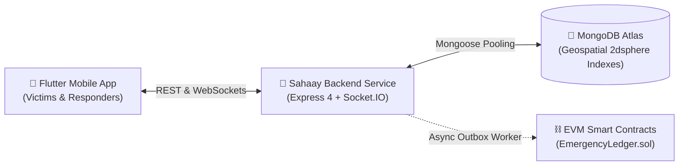

# Sahaay Backend Production Hosting & Deployment Guide

This document provides step-by-step instructions to host the **Sahaay Emergency Response Backend** in production, configure the **MongoDB database**, and deploy the **EVM Blockchain Trust Layer** for the MVP.

---

## 1. Quick Architecture Overview



---

## 2. Database Readiness (MongoDB Atlas)

The backend is pre-configured to connect to MongoDB Atlas (or any cloud MongoDB replica set) with connection pooling and automatic index initialization.

### Step 1: Network Access
1. In your [MongoDB Atlas Console](https://cloud.mongodb.com):
2. Navigate to **Network Access** → **IP Access List**.
3. Add IP Address: `0.0.0.0/0` (Allow access from anywhere, required for dynamic cloud hosting like Render/Railway/Fly.io).

### Step 2: Connection String
Format:
```
mongodb+srv://<username>:<password>@<cluster>.mongodb.net/sahaay?retryWrites=true&w=majority
```

### Step 3: Automatic Index Syncing
On startup, the backend automatically calls:
- `Emergency.syncIndexes()` (Creates `2dsphere` on `location` and `{ status: 1, ownerId: 1 }`)
- `ResponderProfile.syncIndexes()` (Creates `2dsphere` on `location`)
- `User.syncIndexes()` (Creates unique constraint on `phone`)
- `ProofOutbox.syncIndexes()` (Creates unique compound index on `{ emergencyId: 1, eventType: 1 }`)

No manual database migrations or schema adjustments are needed.

---

## 3. Blockchain Layer MVP Specifics

Sahaay features a dual-mode trust layer designed specifically for hackathons, MVPs, and production:

### Mode A: Instant MVP Simulation Mode (Zero-Gas Setup — Recommended for MVP)
If you host the backend without providing blockchain testnet funds or RPC credentials, the backend **automatically enters MVP Simulation Mode**:
1. When an emergency milestone occurs (`ARRIVED` or `RESOLVED`), the backend computes the canonical SHA-256 digest of the event payload.
2. The asynchronous `ProofWorker` processes the outbox record, produces a deterministic `keccak256` transaction hash (`0x...`), and marks the proof `CONFIRMED`.
3. The mobile application immediately displays real cryptographic transaction hashes on the Active SOS and History screens without requiring external testnet gas.

### Mode B: Live On-Chain EVM Deployment (Sepolia / Polygon Amoy / Base Sepolia)
If you want to deploy and audit proofs live on a public EVM testnet:

1. **Configure Environment in `blockchain/.env`**:
   ```bash
   cd blockchain
   cp .env.example .env
   ```
   Add your testnet RPC and funded deployer private key:
   ```ini
   RPC_URL=https://sepolia.infura.io/v3/YOUR_INFURA_KEY
   CHAIN_ID=11155111
   DEPLOYER_PRIVATE_KEY=0xYOUR_FUNDED_PRIVATE_KEY
   BACKEND_ATTESTOR_ADDRESS=0xYOUR_BACKEND_HOT_WALLET_PUBLIC_ADDRESS
   ADMIN_VERIFIER_ADDRESS=0xYOUR_VERIFIER_PUBLIC_ADDRESS
   ```

2. **Deploy Smart Contracts**:
   ```bash
   npx hardhat run scripts/deploy.ts --network localhost
   # Or for public testnet:
   # npx hardhat run scripts/deploy.ts --network sepolia
   ```
   This script:
   - Deploys `ResponderRegistry.sol`
   - Deploys `EmergencyLedger.sol`
   - Grants `ATTESTOR_ROLE` to your backend hot wallet
   - Automatically exports updated ABIs and addresses to `backend/src/contracts/addresses.json`!

3. **Provide Environment Variables to Backend**:
   - `BLOCKCHAIN_RPC_URL` = Your testnet RPC endpoint
   - `BLOCKCHAIN_PRIVATE_KEY` = Backend attestor wallet private key
   - `BLOCKCHAIN_EMERGENCY_LEDGER_ADDRESS` = Deployed address
   - `BLOCKCHAIN_CHAIN_ID` = Testnet chain ID (e.g. `11155111` for Sepolia)

---

## 4. Hosting Options (1-Click & Cloud Platforms)

### Option 1: Render.com (Recommended for Free/Cheap Hosting)
1. Fork or push the repo to GitHub.
2. In Render Dashboard, click **New +** → **Web Service**.
3. Connect your repository and select the **Docker** runtime:
   - **Root Directory**: `backend` (or use `./backend/Dockerfile`)
   - **Port**: `3000`
   - **Health Check Path**: `/health`
4. Add the **Environment Variables**:
   ```ini
   PORT=3000
   NODE_ENV=production
   CORS_ORIGIN=*
   MONGODB_URI=mongodb+srv://...
   JWT_SECRET=your-random-64-char-secret
   ```
5. Click **Deploy Web Service**. Render will build the multi-stage Docker container and give you a public URL (e.g., `https://sahaay-api.onrender.com`).

---

### Option 2: Railway.app
1. In Railway, click **New Project** → **Deploy from GitHub repo**.
2. Select the repository and set the root directory to `backend`.
3. Railway automatically detects `backend/Dockerfile`.
4. Under **Variables**, add:
   - `MONGODB_URI`
   - `JWT_SECRET`
   - `PORT=3000`
   - `CORS_ORIGIN=*`
5. Generate a public domain in **Settings** → **Networking**.

---

### Option 3: Docker Compose (Self-Hosted VPS / DigitalOcean / EC2)
Clone the repository on your server and run:
```bash
# 1. Clone repo
git clone https://github.com/Shivamraj2006/Sahaay.git
cd Sahaay

# 2. Configure environment
cp backend/.env.production.example backend/.env
nano backend/.env # paste your MONGODB_URI and JWT_SECRET

# 3. Launch with Docker Compose
docker compose up -d --build
```
Check health:
```bash
curl http://localhost:3000/health
```

---

## 5. Verification & Health Check

Once hosted, test the public URL with curl:
```bash
curl https://your-hosted-backend.com/health
```
Expected 200 OK JSON response:
```json
{
  "status": "ok",
  "service": "sahaay-backend",
  "timestamp": "2026-10-11T12:59:11.733Z",
  "version": "1.0.0",
  "database": {
    "connected": true
  },
  "blockchain": {
    "mode": "on-chain",
    "ledgerConfigured": true,
    "chainId": 31337
  }
}
```

---

## 6. Connecting the Flutter App to the Hosted Backend

Once your backend is live (e.g. `https://sahaay-api.onrender.com`), connect the Flutter client in two ways:

### Option A: Build-time define (Recommended for production APK)
```bash
cd frontend
flutter run --dart-define=BACKEND_HOST=https://sahaay-api.onrender.com
# Or to build APK:
flutter build apk --dart-define=BACKEND_HOST=https://sahaay-api.onrender.com
```

### Option B: Runtime Settings
On the physical mobile device:
1. Open the app.
2. Tap the **Settings** tab.
3. Verify the **Backend REST Endpoint** and **Socket.IO Real-Time Gateway** display your live server address.
