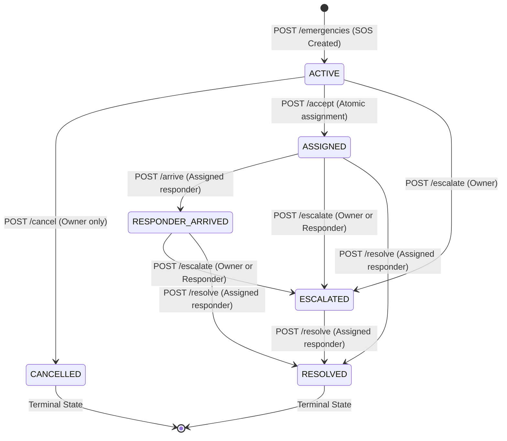
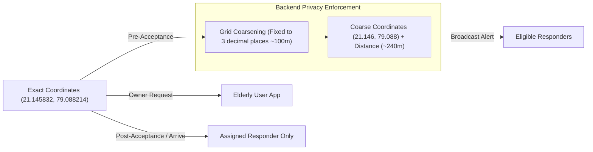

# Sahaay Backend Architecture

The Sahaay backend is the authoritative operational engine of the system. It orchestrates real-time emergency dispatch, validates identities, enforces location privacy, maintains the emergency state machine, and asynchronously bridges milestone proofs to the blockchain.

---

## 1. Technology Stack

| Layer | Component | Technology | Rationale |
|---|---|---|---|
| **Runtime** | Execution Environment | Node.js (v18+) & TypeScript (v5.x) | Strong type-safety, async I/O, unified ecosystem. |
| **HTTP Framework** | Web Server | Express 4.x | Fast, lightweight REST routing and mature middleware pipeline. |
| **Database** | Persistent Storage | MongoDB & Mongoose 8.x | Native GeoJSON geospatial querying (`$nearSphere`), schema validation. |
| **Real-Time** | WebSocket Layer | Socket.IO 4.x | Bidirectional, room-partitioned push notifications with fallback transports. |
| **Validation** | Request DTO Schema | Zod 3.x | Runtime and compile-time type validation with centralized error schemas. |
| **Authentication** | Access Tokens | JWT (`jsonwebtoken`) & bcrypt | Stateless token-based auth with secure password hashing. |
| **Blockchain Bridge** | Trust Submissions | Ethers.js v6 | Type-safe JSON-RPC client for smart-contract interactions. |
| **Testing** | Automated Test Suite | Vitest 2.x & Supertest | Sub-second test execution across unit and integration suites. |

---

## 2. Module Organization & Clean Architecture

The backend follows a domain-driven modular structure located in [`backend/src/`](file:///home/shivam/Projects/Sahay/backend/src):

```
backend/src/
├── config/                  # Environment & runtime configurations
│   ├── database.ts          # MongoDB connection lifecycle
│   └── index.ts             # Strongly-typed environment variables & defaults
├── contracts/               # Smart contract ABIs and network addresses
│   ├── EmergencyLedger.json
│   ├── ResponderRegistry.json
│   └── addresses.json
├── middleware/              # Express HTTP middleware pipeline
│   ├── auth.ts              # JWT token verification
│   ├── authorize.ts         # Role-based access control (RBAC)
│   ├── errorHandler.ts      # Standardized JSON error response envelope
│   ├── rateLimit.ts         # IP-based rate limiting
│   └── requestId.ts         # Correlation ID injection
├── models/                  # Mongoose domain entities & schema declarations
│   ├── User.ts
│   ├── ResponderProfile.ts
│   ├── Emergency.ts
│   ├── EmergencyEvent.ts
│   ├── ProofOutbox.ts
│   └── VerificationAudit.ts
├── modules/                 # Functional domain features
│   ├── admin/               # Responder application verification & revocation
│   ├── auth/                # Registration, credential login, token issuance
│   ├── emergencies/         # Core SOS lifecycle, state changes, transitions
│   ├── matching/            # Proximity calculation, radius expansion, candidate query
│   ├── realtime/            # Socket.IO connection handling & authenticated rooms
│   ├── responders/          # Responder profile, availability, history, reputation
│   ├── trust/               # Canonical proof formatting, hashing & outbox worker
│   └── users/               # Current user profile retrieval & updates
└── shared/                  # Common primitives, domain enums & custom errors
    ├── enums.ts
    ├── errors.ts
    └── types.ts
```

---

## 3. Domain Models & Database Schemas

### 3.1. `User` Model ([`models/User.ts`](file:///home/shivam/Projects/Sahay/backend/src/models/User.ts))
Represents account credentials and core role assignment.
* **Fields**: `_id`, `displayName`, `phone` (unique index, normalized E.164), `passwordHash` (bcrypt salt rounds = 10), `role` (`ELDERLY_USER`, `VOLUNTEER`, `MEDICAL_PROFESSIONAL`, `ORGANIZATION_COORDINATOR`, `VERIFIER`, `ADMIN`), timestamps.
* **Security Guard**: Users cannot self-assign `VERIFIER` or `ADMIN` roles during registration.

### 3.2. `ResponderProfile` Model ([`models/ResponderProfile.ts`](file:///home/shivam/Projects/Sahay/backend/src/models/ResponderProfile.ts))
Operational metadata for community volunteers and medical responders.
* **Fields**: `userId` (unique reference to `User`), `verificationStatus` (`UNVERIFIED`, `PENDING`, `VERIFIED`, `REVOKED`), `available` (boolean), `capabilities` (array of capability tags), `location` (GeoJSON `Point`), `locationUpdatedAt` (timestamp for freshness validation), `completedCount` (total confirmed missions), `reputationScore` (score metric).
* **Indexes**: `{ location: '2dsphere' }` for high-performance spatial queries, `{ verificationStatus: 1, available: 1 }`.

### 3.3. `Emergency` Model ([`models/Emergency.ts`](file:///home/shivam/Projects/Sahay/backend/src/models/Emergency.ts))
Authoritative record for an emergency rescue operation.
* **Fields**:
  * `ownerId`: Foreign key to elderly user.
  * `category`: `MEDICAL`, `FALL_INJURY`, `HOSPITAL_ASSISTANCE`.
  * `status`: `ACTIVE`, `ASSIGNED`, `RESPONDER_ARRIVED`, `ESCALATED`, `RESOLVED`, `CANCELLED`.
  * `location`: GeoJSON Point `[longitude, latitude]` holding off-chain exact coordinates.
  * `assignedResponderId`: Populated upon atomic responder assignment (null when unclaimed).
  * `version`: Optimistic concurrency version integer incremented on every state mutation.
  * `resolution`: `{ outcome, note, resolvedAt }` (e.g., `ASSISTED`, `REFERRED_TO_EMERGENCY_SERVICES`).
  * `escalation`: `{ isEscalated, reason, escalatedAt }`.
  * `proof`: `{ status, transactionHash }` tracking on-chain attestation.
* **Indexes**: `{ status: 1, location: '2dsphere' }`.

### 3.4. `EmergencyEvent` Model ([`models/EmergencyEvent.ts`](file:///home/shivam/Projects/Sahay/backend/src/models/EmergencyEvent.ts))
Append-only historical audit trail for every operational state change.
* **Fields**: `emergencyId`, `actorId`, `actorRole`, `eventType` (`CREATED`, `ACCEPTED`, `DECLINED`, `ARRIVED`, `RESOLVED`, `ESCALATED`, `CANCELLED`), `previousStatus`, `nextStatus`, `version`, `correlationId`, `metadata`.

### 3.5. `ProofOutbox` Model ([`models/ProofOutbox.ts`](file:///home/shivam/Projects/Sahay/backend/src/models/ProofOutbox.ts))
Reliable messaging queue for asynchronous blockchain attestation.
* **Fields**: `emergencyId`, `eventType`, `schemaVersion`, `digest` (SHA-256 hex), `proofStatus` (`NOT_SUBMITTED`, `PENDING`, `CONFIRMED`, `FAILED`), `retryCount`, `lastAttemptAt`, `transactionHash`, `failureCode`.
* **Unique Compound Index**: `{ emergencyId: 1, eventType: 1 }` preventing duplicate proof emissions for the same milestone.

---

## 4. State Machine & Concurrency Control

The emergency lifecycle is strictly owned and validated by the backend. Direct client state overrides are forbidden.



### Atomic Assignment Guard (Anti-Race Condition)
To guarantee that two responders racing to accept the same incident do not both succeed, assignment uses MongoDB's atomic conditional update:

```typescript
const emergency = await Emergency.findOneAndUpdate(
  {
    _id: emergencyId,
    status: EmergencyStatus.ACTIVE,
    assignedResponderId: null, // Guard condition
  },
  {
    $set: {
      status: EmergencyStatus.ASSIGNED,
      assignedResponderId: user.userId,
    },
    $inc: { version: 1 },
  },
  { new: true }
);

if (!emergency) {
  // If the query returned null, another responder won the race
  throw new ConflictError(
    'EMERGENCY_ALREADY_ASSIGNED',
    'This emergency has already been assigned or is no longer active.'
  );
}
```

---

## 5. Geospatial Matching Engine

Located in [`modules/matching/matching.service.ts`](file:///home/shivam/Projects/Sahay/backend/src/modules/matching/matching.service.ts), the matching engine implements expanding radius tiers:

1. **Expansion Tiers**:
   * **Tier 0**: 500 meters (Immediate vicinity).
   * **Tier 1**: 1,000 meters (Local community).
   * **Tier 2**: 3,000 meters (Maximum urban responder boundary).
2. **Expansion Timing**:
   * The backend searches Tier 0 immediately upon SOS creation.
   * If no candidates are found, it waits for `expansionDelayMs` (default: 10s in production, 2s in demo mode) before progressing to the next ring.
   * Expansion immediately halts as soon as any candidate is found or the incident moves out of `ACTIVE`.
3. **Candidate Qualification**:
   To be eligible for an alert, a responder must meet ALL criteria:
   * `verificationStatus === 'VERIFIED'`
   * `available === true`
   * `locationUpdatedAt >= NOW - 5 minutes` (Location freshness guard)
   * Spatial distance $\le$ current tier radius
   * Has not been previously notified for this incident (Notification deduplication)
4. **Deterministic Ranking**:
   Candidates within a tier are ranked by Haversine distance ascending; ties are broken by `completedCount` descending.

---

## 6. Location Privacy & Coarsening Architecture

To protect the physical security and dignity of elderly users, Sahaay enforces strict information compartmentalization:



* **Grid Precision**: Coarsening rounds coordinates to 3 decimal places, establishing an uncertainty radius of approximately 111 meters at the equator.
* **Redaction Policy**: Pre-acceptance API responses and WebSocket alerts completely omit the elderly user's name, phone number, and exact address.

---

## 7. Real-Time WebSocket Infrastructure

Located in [`modules/realtime/socket.ts`](file:///home/shivam/Projects/Sahay/backend/src/modules/realtime/socket.ts), Socket.IO provides low-latency notification dispatch:

### 7.1. Authenticated Rooms
Every connecting client must provide a valid JWT bearer token in `auth.token`. The server automatically partitions connections into:
* `user:<userId>`: Individual user room for targeted notifications (e.g., candidate emergency alerts).
* `emergency:<emergencyId>`: Multi-cast incident room joined only by authorized participants (owner and assigned responder).

### 7.2. Standard Event Envelope
All emitted socket messages conform to a strict schema:

```json
{
  "eventId": "66f7a8b9c0d1e2f3a4b5c6e9-responder.accepted-1760172600000",
  "occurredAt": "2026-10-11T08:30:00.000Z",
  "emergencyId": "66f7a8b9c0d1e2f3a4b5c6e9",
  "version": 2,
  "data": {
    "status": "ASSIGNED"
  }
}
```

---

## 8. Security & Compliance Matrix

1. **Role-Based Access Control (RBAC)**:
   * Protected routes enforce `authenticate` and `requireRole(...)`.
   * Non-responders cannot call responder endpoints.
   * Regular users cannot access `/api/v1/admin/*`.
2. **Standard Error Envelope**:
   All errors conform to a unified format that never exposes stack traces, database internals, or private credentials:
   ```json
   {
     "error": {
       "code": "FORBIDDEN",
       "message": "You are not authorized to perform this action.",
       "requestId": "4f9d2c1e-...",
       "details": {}
     }
   }
   ```
3. **Audit Trails**:
   Every verification, revocation, and milestone transition writes a permanent, non-mutating event entry in MongoDB.
