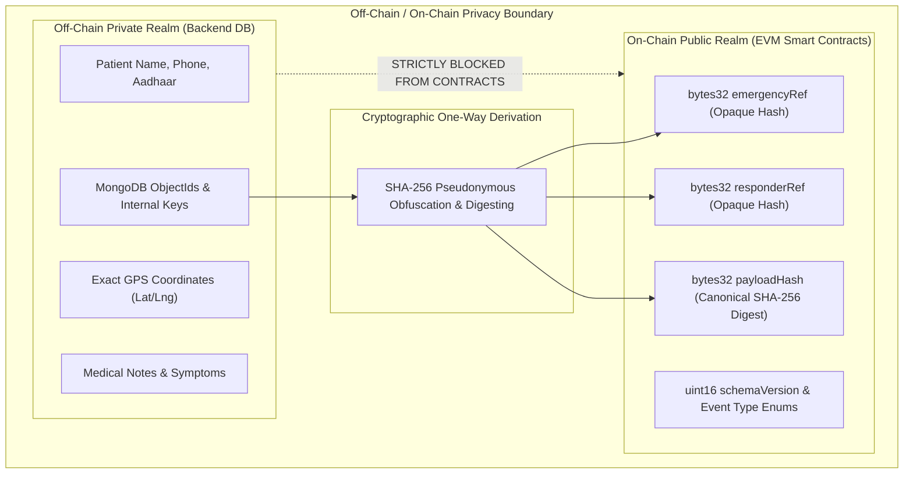
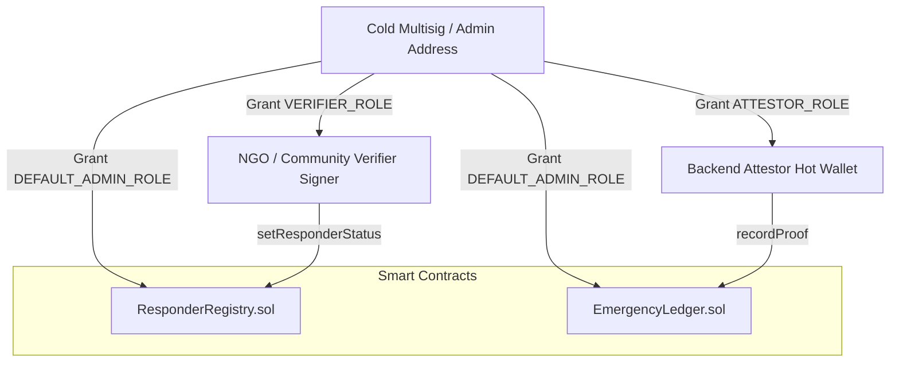
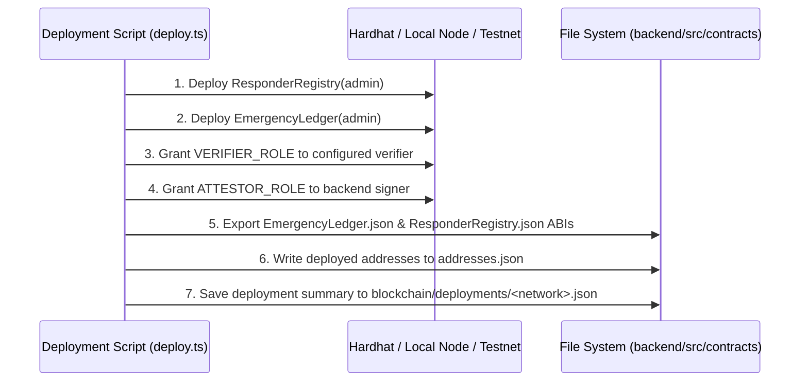

# Sahaay Blockchain Trust Layer Architecture

The Blockchain Layer provides an immutable, decentralized audit trail for the Sahaay community emergency-response ecosystem. Built on Ethereum Virtual Machine (EVM) architecture, it guarantees tamper-evident logging of responder credentials and mission milestone proofs without storing any private or personal data.

---

## 1. Executive Summary & Design Principles



### Core Invariants:
1. **Zero Personal Identifiable Information (PII)**:
   Smart contract storage, transaction calldata, and emitted event logs are strictly forbidden from containing real names, phone numbers, exact GPS coordinates, medical records, or database primary keys.
2. **Audit Layer, Not Dispatch Engine**:
   The blockchain is solely an audit and verification ledger. It does **not** handle emergency routing, geospatial queries, or push notifications. High gas fees or blockchain reorgs never block emergency response.
3. **No Speculative Economics**:
   There are no native ERC-20 tokens, speculative rewards, staking penalties, or NFT collectibles. Responders are motivated by community duty, and reputation is an attested operational track record.

---

## 2. Smart Contract Specifications

The trust layer comprises two modular, audited contracts deployed in [`blockchain/contracts/`](file:///home/shivam/Projects/Sahay/blockchain/contracts):

### 2.1. `ResponderRegistry.sol` ([`contracts/ResponderRegistry.sol`](file:///home/shivam/Projects/Sahay/blockchain/contracts/ResponderRegistry.sol))

Maintains on-chain credential attestations for community volunteers and medical responders.

* **Inheritance**: OpenZeppelin `AccessControl` (`^5.0.0`).
* **Roles**:
  * `DEFAULT_ADMIN_ROLE`: Configures verified authority addresses.
  * `VERIFIER_ROLE`: Granted to NGO administrators, community verifiers, or background-check coordinators.

#### Status Enum:
```solidity
enum VerificationStatus {
    UNVERIFIED, // 0 - Default unverified state
    VERIFIED,   // 1 - Authorized, background-checked responder
    REVOKED     // 2 - Access revoked due to safety or compliance breach
}
```

#### State Variables:
* `mapping(bytes32 => VerificationStatus) private _responderStatuses`: Maps pseudonymous responder references to their active verification status.

#### Key Functions:
| Function | Access Guard | Description |
|---|---|---|
| `setVerifier(address account, bool enabled)` | `onlyRole(DEFAULT_ADMIN_ROLE)` | Grants or revokes verifier privileges. |
| `setResponderStatus(bytes32 responderRef, VerificationStatus status)` | `onlyRole(VERIFIER_ROLE)` | Attests responder status changes (`VERIFIED` or `REVOKED`). |
| `getResponderStatus(bytes32 responderRef)` | Public View | Returns the verification state (unregistered responders default to `UNVERIFIED`). |
| `isVerified(bytes32 responderRef)` | Public View | Helper returning `true` only if status is strictly `VERIFIED`. |

#### Emitted Event:
```solidity
event ResponderStatusChanged(
    bytes32 indexed responderRef,
    VerificationStatus status,
    address indexed verifier,
    uint256 timestamp
);
```

---

### 2.2. `EmergencyLedger.sol` ([`contracts/EmergencyLedger.sol`](file:///home/shivam/Projects/Sahay/blockchain/contracts/EmergencyLedger.sol))

Tamper-evident audit ledger recording non-repudiable milestone proofs for emergency incidents.

* **Inheritance**: OpenZeppelin `AccessControl` (`^5.0.0`).
* **Roles**:
  * `DEFAULT_ADMIN_ROLE`: Contract administrator.
  * `ATTESTOR_ROLE`: Backend operational hot wallet authorized to record rescue proofs.

#### Milestone Event Types:
```solidity
enum ProofEventType {
    RESPONDER_ARRIVED, // 0 - Milestone: assigned responder reached the patient
    EMERGENCY_RESOLVED  // 1 - Milestone: emergency closed with verified outcome
}
```

#### Storage Struct (`ProofRecord`):
```solidity
struct ProofRecord {
    bytes32 proofId;         // Unique, non-reusable identifier
    bytes32 emergencyRef;    // Opaque pseudonymous emergency reference
    bytes32 responderRef;    // Opaque pseudonymous responder reference
    ProofEventType eventType;// Milestone type (0 or 1)
    uint16 schemaVersion;    // Canonical serialization schema version
    bytes32 payloadHash;     // SHA-256 digest of canonical proof record
    address attestor;        // Address that signed the transaction
    uint256 blockTimestamp;  // EVM block timestamp
    bool exists;             // Existence guard for replay protection
}
```

#### Replay Protection & Invariants:
1. Every proof record is stored under a unique `proofId`.
2. Any repeated submission with an identical `proofId` reverts with `PROOF_ALREADY_RECORDED`.
3. Parameter validations enforce that `proofId`, `emergencyRef`, `responderRef`, and `payloadHash` must be non-zero `bytes32` values, and `schemaVersion > 0`.

#### Emitted Event:
```solidity
event ProofRecorded(
    bytes32 indexed proofId,
    bytes32 indexed emergencyRef,
    bytes32 indexed responderRef,
    ProofEventType eventType,
    uint16 schemaVersion,
    bytes32 payloadHash,
    address attestor,
    uint256 blockTimestamp
);
```

---

## 3. Cryptographic Identity & Pseudonymity Model

To decouple internal database identifiers from the public ledger, Sahaay uses deterministic one-way SHA-256 hash derivations:

### Reference Derivation Formula:
$$\text{ref} = \text{SHA256}(\text{prefix} \parallel \text{":"} \parallel \text{id})[0..16]$$

* **Emergency Reference**: `emergencyRef = deriveOpaqueRef("emergency", emergencyId)`
* **Responder Reference**: `responderRef = deriveOpaqueRef("responder", responderId)`
* **Proof Identifier**: `proofId = deriveOpaqueRef("proof", emergencyId + ":" + eventType)`

On EVM contracts, these 16-character hex strings or MongoDB IDs are transformed into full `bytes32` identifiers via `ethers.id(...)` or fixed-width byte packing, ensuring zero linkability to personal identity for any external blockchain observer.

---

## 4. Role-Based Access Control (RBAC) Architecture

Sahaay avoids monolithic ownership by isolating administrative governance from daily operational attestation:



* **Attestor Compromise Containment**: If the backend hot wallet's private key is compromised, it cannot alter responder verifications or take administrative control of the contracts; it can only attest milestone proofs. The admin can immediately revoke its `ATTESTOR_ROLE`.

---

## 5. Gas Optimization & Storage Economics

Because emergency systems operate at scale, smart contracts are optimized for minimal storage overhead:

1. **Fixed-Size Data Types**: Structs avoid dynamic arrays or strings, using fixed-width `bytes32`, `uint16`, `address`, and `uint256`.
2. **Event-Indexed Searchability**: Critical lookup keys (`proofId`, `emergencyRef`, `responderRef`) are marked `indexed` in events. Observers and auditors can query history directly using EVM logs without costly on-chain iterative lookups.
3. **Compiler Tuning**: Deployed with Solidity `0.8.20` using the optimizer enabled with `runs: 200`.

---

## 6. Deployment & Cross-Layer Artifact Pipeline

The deployment process is fully automated via [`blockchain/scripts/deploy.ts`](file:///home/shivam/Projects/Sahay/blockchain/scripts/deploy.ts):



This automated export guarantees that the backend always operates against up-to-date ABIs and contract addresses without manual copy-paste errors.
