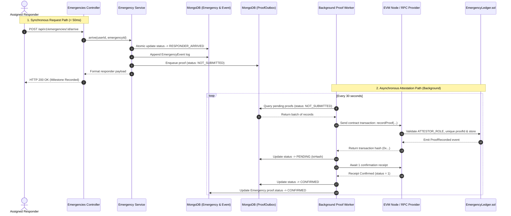
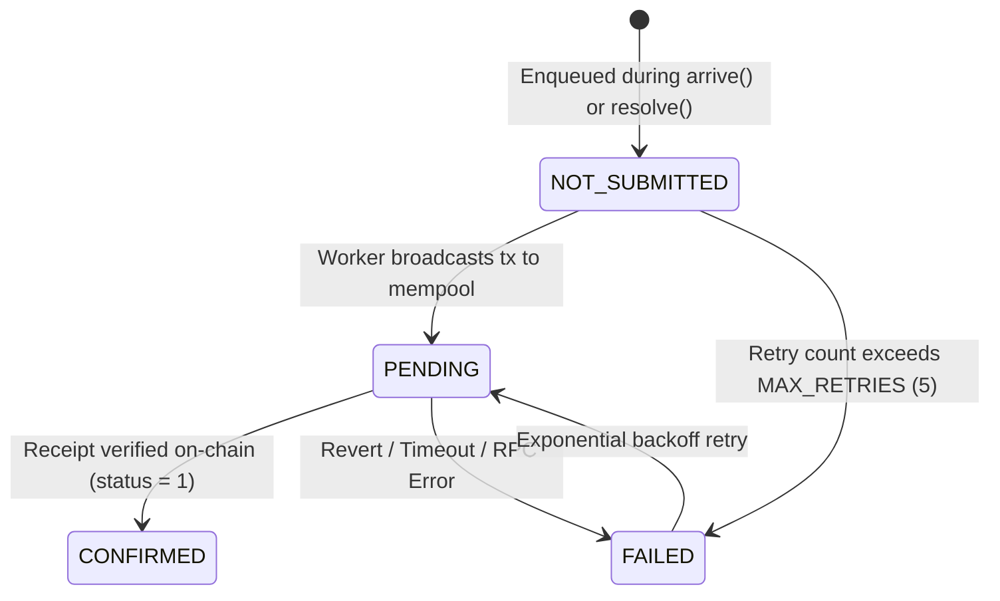

# Sahaay Cross-Layer Integration & Trust Protocol

This document details the interface, data guarantees, and asynchronous outbox protocol that bridge the **Node.js Operational Backend** and the **Solidity EVM Blockchain Trust Layer**.

---

## 1. Architectural Philosophy: Decoupled Trust

A primary failure mode in Web3 healthcare/safety architectures is coupling emergency dispatch with blockchain RPC calls. Sahaay solves this via a strict architectural separation:

```
┌────────────────────────────────────────────────────────┐
│                   OPERATIONAL REALM                    │
│   • Millisecond dispatch latency                       │
│   • In-memory geospatial indexing                      │
│   • WebSocket alerts to nearby responders              │
│   • Authoritative state machine transitions            │
└───────────────────────────┬────────────────────────────┘
                            │ Asynchronous Proof Outbox
                            ▼
┌────────────────────────────────────────────────────────┐
│                      AUDIT REALM                       │
│   • Immutable, non-repudiable transaction receipts     │
│   • Publicly verifiable responder attestations         │
│   • Cryptographic zero-PII canonical hashes            │
│   • Independent third-party auditability               │
└────────────────────────────────────────────────────────┘
```

**Golden Rule**: *The blockchain is an asynchronous auditor, never a synchronous gatekeeper.*

---

## 2. The Asynchronous Outbox Pattern

To achieve 100% operational reliability regardless of blockchain network status, Sahaay implements the **Transactional Outbox Pattern**:



### Outbox State Lifecycle:


---

## 3. Canonical Hashing Specification

To ensure cross-layer determinism where Solidity contracts and Node.js backends agree on milestone authenticity, both layers adhere to a **Frozen Canonical Serialization Standard** implemented in [`backend/src/modules/trust/canonical.ts`](file:///home/shivam/Projects/Sahay/backend/src/modules/trust/canonical.ts).

### 3.1. Normalization Rules
1. **Schema Version**: Fixed integer (`schemaVersion = 1`).
2. **Alphabetical Key Sorting**: Object keys must be serialized in lexicographical order (`Object.keys(record).sort()`).
3. **No Insignificant Whitespace**: JSON strings are condensed with zero spaces around colons or commas.
4. **Normalized UTC Timestamps**: Timestamps follow ISO 8601 UTC with second-level precision, stripping milliseconds (e.g., `2026-10-11T08:30:00Z`).
5. **No Floating-Point Coordinates**: Coordinates are omitted to prevent IEEE 754 precision mismatches between languages.
6. **Hashing Primitive**: Standard SHA-256 producing a 64-character lowercase hex string, packed as `bytes32` for Solidity.

### 3.2. Record Schema Structure
```json
{
  "emergencyRef": "8f6828b1e4277b94",
  "eventType": "ARRIVED",
  "occurredAt": "2026-10-11T08:30:00Z",
  "proofId": "e9f50cb90e7a1e0b",
  "responderRef": "a52e25fa9e4210bc",
  "schemaVersion": 1
}
```

---

## 4. Cross-Layer Test Vectors

The integrity of this cross-layer hashing standard is verified via automated test vectors in [`backend/src/modules/trust/test-vectors.ts`](file:///home/shivam/Projects/Sahay/backend/src/modules/trust/test-vectors.ts). These exact vectors are executed in both backend Vitest tests and Hardhat smart contract tests:

### Vector 1: Responder Arrival Milestone
* **Canonical JSON**:
  ```json
  {"emergencyRef":"8f6828b1e4277b94","eventType":"ARRIVED","occurredAt":"2026-10-11T08:30:00Z","proofId":"e9f50cb90e7a1e0b","responderRef":"a52e25fa9e4210bc","schemaVersion":1}
  ```
* **Expected SHA-256 Digest**:
  ```
  b6fe811fa1d8e1293baaa2fec3235bca253c05423cc81a17fa2b67f405cff15b
  ```
* **Solidity `bytes32` Argument**:
  ```
  0xb6fe811fa1d8e1293baaa2fec3235bca253c05423cc81a17fa2b67f405cff15b
  ```

### Vector 2: Emergency Resolved (Assisted)
* **Canonical JSON**:
  ```json
  {"emergencyRef":"8f6828b1e4277b94","eventType":"RESOLVED","occurredAt":"2026-10-11T08:45:00Z","outcome":"ASSISTED","proofId":"c1d4e7f9a2b5e8c3","responderRef":"a52e25fa9e4210bc","schemaVersion":1}
  ```
* **Expected SHA-256 Digest**:
  ```
  d782782e4a8b79e782be125a07357404415e9a4f4dbe70f9fe0a56fe73e35492
  ```

### Vector 3: Emergency Resolved (Referred to Emergency Services)
* **Canonical JSON**:
  ```json
  {"emergencyRef":"4c2e8a1f7b9d3e5a","eventType":"RESOLVED","occurredAt":"2026-10-11T09:15:00Z","outcome":"REFERRED_TO_EMERGENCY_SERVICES","proofId":"f8a2c4e6b1d3f5a7","responderRef":"e3b7c9a1d5f2a8e4","schemaVersion":1}
  ```
* **Expected SHA-256 Digest**:
  ```
  a455a16d8a39ec8a74ec49175f8f8b50259b36263e808064ea547e24823a493a
  ```

---

## 5. Resilience & Fault Isolation Matrix

| Failure Scenario | Impact on User Experience | Recovery Mechanism |
|---|---|---|
| **EVM RPC Offline** | **Zero Impact**: SOS dispatch, responder notifications, and arrivals proceed normally. | Worker logs RPC timeout, increments `retryCount`, and retries during the next 30-second cycle. |
| **Gas Price Spikes** | **Zero Impact**: Emergency operations continue uninterrupted. | Outbox records queue up in MongoDB; worker drains the backlog when network conditions stabilize. |
| **Worker Process Crash** | **Zero Impact**: Express API and database remain healthy. | On process restart, worker queries `NOT_SUBMITTED` and `PENDING` outbox records and resumes execution. |
| **Duplicate Event Attempt** | **None**: First attempt succeeds, duplicate is rejected. | Protected by MongoDB unique index `{ emergencyId, eventType }` and smart contract `require(!_proofs[proofId].exists)`. |
| **Invalid Hot Wallet Signature** | **Zero Impact on Dispatch**: Milestone committed to MongoDB. | Transaction reverts with `AccessControlUnauthorizedAccount`. Admin re-grants `ATTESTOR_ROLE` without loss of data. |

---

## 6. Verification Guide for External Auditors

Any third-party auditor, NGO partner, or hospital coordinator can independently verify that an emergency resolution recorded on the blockchain was genuine and unaltered:

1. **Obtain Proof Record from Blockchain**:
   Call `EmergencyLedger.getProof(proofId)` using standard JSON-RPC.
2. **Retrieve Off-Chain Event Record**:
   Request the corresponding audit log entry from the Sahaay audit export API.
3. **Recompute Canonical Digest**:
   Pass the off-chain fields (`emergencyRef`, `responderRef`, `eventType`, `occurredAt`, `outcome`) through the canonical JSON serializer.
4. **Compare Digest to On-Chain `payloadHash`**:
   $$\text{SHA256}(\text{Canonical JSON}) \stackrel{?}{=} \text{ProofRecord.payloadHash}$$
   If the digests match, mathematical proof is established that the record was not altered or forged post-incident.
