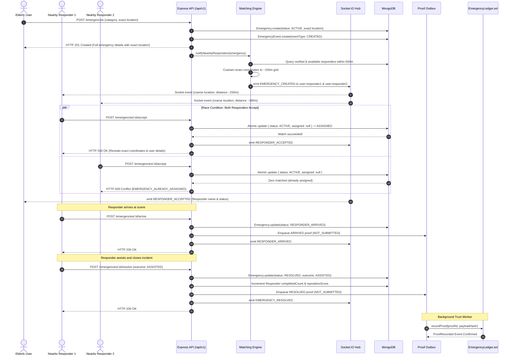
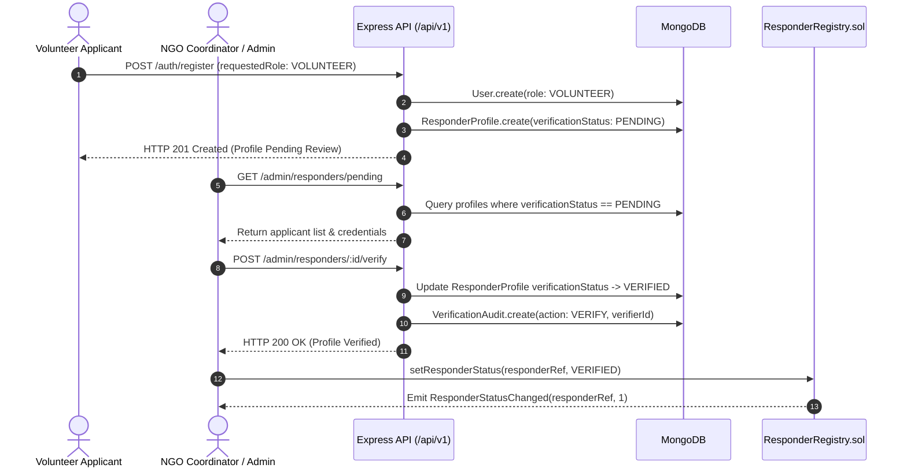

# Sahaay Data Flows, State Machine & Security Architecture

This document provides end-to-end event sequence diagrams, formal state transitions, threat models, and privacy enforcement policies across the Sahaay ecosystem.

---

## 1. End-to-End Event Sequence Flows

### 1.1. Core Incident Lifecycle (SOS $\to$ Match $\to$ Assign $\to$ Arrive $\to$ Resolve $\to$ Blockchain)

---

### 1.2. Responder Credentialing Lifecycle

---

## 2. Emergency State Machine Specification

The state machine implements strict validation guards to prevent illegal transitions:

| Current Status | Target Status | Triggering Action | Allowed Actor | Guard Conditions |
|---|---|---|---|---|
| *Initial* | `ACTIVE` | `POST /emergencies` | `ELDERLY_USER` | Authenticated owner; valid category and location. |
| `ACTIVE` | `ASSIGNED` | `POST /emergencies/:id/accept` | `RESPONDER` | Atomic match: `status == ACTIVE` and `assignedResponderId == null`. Responder must be `VERIFIED` and `available`. |
| `ACTIVE` | `CANCELLED` | `POST /emergencies/:id/cancel` | `ELDERLY_USER` | Incident owner only; cannot cancel once assigned. |
| `ASSIGNED` | `RESPONDER_ARRIVED` | `POST /emergencies/:id/arrive` | `RESPONDER` | Assigned responder only; cannot arrive if unassigned. |
| `ACTIVE` / `ASSIGNED` / `RESPONDER_ARRIVED` | `ESCALATED` | `POST /emergencies/:id/escalate` | `ELDERLY_USER` or `RESPONDER` | Must provide escalation reason; preserves existing assigned responder and event history. |
| `ASSIGNED` / `RESPONDER_ARRIVED` / `ESCALATED` | `RESOLVED` | `POST /emergencies/:id/resolve` | `RESPONDER` | Assigned responder only; valid resolution outcome required (`ASSISTED`, `REFERRED_TO_EMERGENCY_SERVICES`, etc.). |

---

## 3. Threat Modeling & Security Mitigations

| Threat Vector | Attack Mechanism | Sahaay Mitigation Strategy |
|---|---|---|
| **Stalking / Location Privacy Harvest** | Rogue responder creates account to spy on elderly residents' locations. | **1. Location Coarsening**: Pre-acceptance coordinates are rounded to ~100m grid cells. **2. Strict RBAC**: Unverified or unavailable responders cannot query `/emergencies/nearby`. **3. Post-Acceptance Auditing**: Exact coordinates are revealed to exactly ONE responder per incident, backed by immutable audit logs. |
| **Race Conditions (Double Assignment)** | Two responders simultaneously click "Accept" on the same SOS. | **Atomic Conditional Update**: MongoDB `findOneAndUpdate({ _id, status: 'ACTIVE', assignedResponderId: null })`. Only the first database write succeeds; the second receives HTTP `409 Conflict`. |
| **Privilege Escalation** | Attacker registers with `requestedRole: 'ADMIN'` to approve fake responders. | **Role Whitelisting**: Registration middleware rejects privileged roles (`ADMIN`, `VERIFIER`). Administrative credentials are provisioned exclusively via database migrations or seed scripts. |
| **Tampered Incident History** | Rogue database administrator alters resolution outcomes or timestamps. | **Cryptographic On-Chain Attestation**: Any modification of the off-chain record changes the SHA-256 digest, which will fail comparison against the immutable on-chain `payloadHash`. |
| **Hot Wallet Compromise** | Backend server compromised; attacker steals private key. | **Compartmentalized Access Control**: The backend wallet possesses only `ATTESTOR_ROLE`. It cannot transfer contract ownership, mint tokens, or modify responder verification states. Admin multisig can revoke the key instantaneously. |
| **Denial of Service / SOS Spam** | Script floods API with false emergency requests. | **1. IP Rate Limiting**: Express middleware limits high-frequency requests. **2. JWT Session Verification**: Anonymous requests are dropped. **3. Geographic Density Guards**: Duplicate active emergencies for the same user are restricted. |
